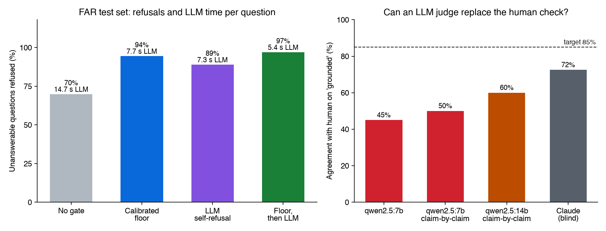

# abstain-rag: a RAG system that knows when to say no

A benchmark of **abstention** for retrieval-augmented generation: when should a RAG system refuse instead of
answering? Built on the US **Federal Acquisition Regulation (FAR)** plus three public BEIR datasets, with free
local models only (bge-small for retrieval, llama3.1:8b for answers, qwen2.5 as a judge).



## Results

> **91% of unanswerable FAR questions refused before any LLM call** by a score floor calibrated *without any
> labeled refusals*, while 96% of answerable ones pass, and **LLM time per question is cut in half**
> (14.7 s to 7.7 s). Adding the LLM's own refusal after the floor raises it to **97%**.

> **A 7B LLM judge agreed with a human only 45% of the time on grounding.** A 14B judge reached 60%.
> Hallucination rates are therefore measured on human-labeled answers, not by the judge.

> **About half of the 8B model's answers contain an unsupported claim** (47%, 95% interval 27-66%), with or
> without a gate. Gates decide *whether* to answer; they do not make answers more faithful.

<!-- CP5 -->

## What is in it

| Step | What | Key number |
|---|---|---|
| CP1 retrieval | bge-small + FAISS, checked against published BEIR scores | within 0.1 nDCG point on all 3 datasets |
| CP2 FAR test set | 719 questions written by an LLM from FAR passages (answerable, near-miss, off-topic), filtered, then 100 reviewed by hand | source section in top 10 for 86.5% |
| CP3 gates | 5 refusal gates from retrieval scores alone: fixed threshold, calibrated floor, + margin, + vocabulary | top-1 score AUROC 0.985 on FAR |
| CP4 generation | answers, the LLM's own refusal (gate 6), floor + LLM stacked, judge checked against 40 human labels | stacked gate refuses 97% of unanswerable at 5.4 s/question |
| CP5 fine-tuning | bge-small fine-tuned on FAR with synthetic questions from sections the test never uses | see below |

### The FAR gates (test set, 503 questions)

| Gate | Coverage | Unanswerable refused | LLM s / question |
|---|---|---|---|
| No gate | 0.67 | 70% | 14.7 |
| Calibrated floor | 0.53 | 94% | 7.7 |
| LLM self-refusal | 0.57 | 89% | 7.3 |
| **Floor, then LLM** | **0.52** | **97%** | **5.4** |

End to end: a question counts as refused if the gate blocks it or the LLM declines in its answer, so "No gate"
still refuses 70%. The floor alone, before any LLM call, refuses 91% (false refusals 4%). Coverage and refusal rates need
no judge: only the question's label and whether the answer refused.

### Checking the judge

| Judge | Agreement with human on "grounded" |
|---|---|
| qwen2.5:7b (used in the run) | 45% |
| qwen2.5:7b, claim-by-claim prompt | 50% |
| qwen2.5:14b, claim-by-claim prompt | 60% |
| Claude (blind, same instructions) | 72.5% |

The local judges miss subtle overclaims: "essential" where the source says "enhances", a hazard ratio from the
wrong row, the wrong FAR paragraph.

## How the calibrated floor works

The floor is the score that nonsense never reaches. 200 "word salad" probes are built from real FAR words
(they look like FAR text to the encoder but ask nothing); the floor is their 95th-percentile top-1 score,
capped so it never refuses more than 10% of known-good dev questions. No labeled unanswerable questions are
needed, so it can be set for any new corpus.

## Run it

```bash
uv sync
uv run pytest -q                                        # 32 tests, no downloads
uv run python scripts/cp1_retrieval.py                  # BEIR + FAR download, index, retrieval check
uv run python scripts/cp2_build_testset.py              # FAR test set (needs Ollama + llama3.1:8b)
uv run python scripts/cp3_gates.py                      # gates 1-5 on four corpora, ~2 min
uv run python scripts/cp4_generate.py --stage llm       # answers + judge, ~3 h on a 16 GB Mac (cached)
uv run python scripts/cp4_generate.py --stage report
uv run python scripts/cp5_finetune.py --stage questions --workers 3
uv run python scripts/cp5_finetune.py --stage train
uv run python scripts/cp5_finetune.py --stage eval
```

Every LLM call is cached on disk, so any long stage can be stopped and resumed.
Step-by-step explanations and self-check questions: [docs/LEARN.md](docs/LEARN.md).

## Limitations

- FAR questions are written by an LLM (then filtered and spot-checked by hand), not collected from real users.
- 40 human labels give wide intervals on hallucination rates; read them as "roughly half".
- One generator (llama3.1:8b). A stronger model would change the faithfulness numbers, not the gate results.
- The refusal detector reads only the first sentence of an answer.

## Data

FAR: acquisition.gov (public domain). BEIR: SciFact, FiQA-2018, NFCorpus (see each dataset's license).
